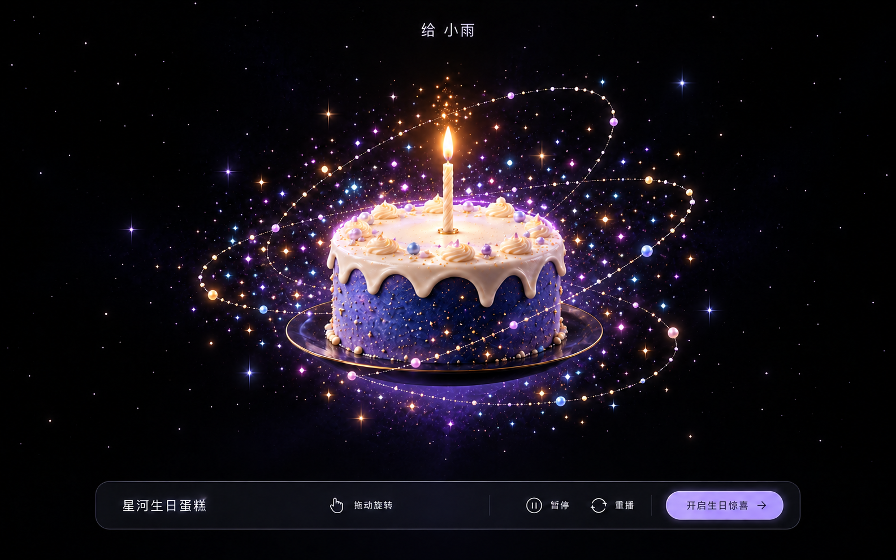
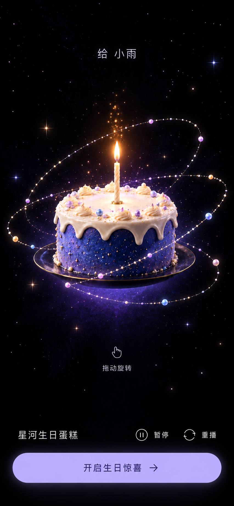

# 已确认视觉基准

2026-11-03 第二阶段续作加入逐层造型、糕体色、奶油色与糖饰定制，最新画面见 [逐层编辑记录](../docs/layer-editor.md)。五瓣奶油花及摄影级目标保留，功能通过不代替摄影级视觉验收。

2026-11-02 第二阶段增加五款、数字蜡烛和设置 UI，见 [stage-two.md](../docs/stage-two.md) 与 [当前草莓款](../docs/qa-stage-two/cake-strawberry.png)、[当前手机爱心款](../docs/qa-stage-two/mobile-375-heart.png)。所有款式沿用低矮五瓣奶油花；被否决的螺旋堆叠不再使用。概念图仍仅为视觉参照，摄影级一致性未标记通过。

2026-11-02 最新实现对照见 [visual-polish.md](../docs/visual-polish.md)、[桌面](../docs/qa-polish/desktop-native.png) 与 [手机](../docs/qa-polish/mobile-390.png)。视觉目标没有重新设计；本轮仍使用下述已确认概念图，摄影级一致性不标记为通过。

> 当前以用户最新要求“跟概念图一样，摄影级细节”为准，按整张画面修改，覆盖蛋糕几何、材质、布光、火焰、粒子及构图。最新上传原图保存为 [photographic-reference.png](photographic-reference.png)，当前对照见 [concept-match.md](../docs/concept-match.md)。概念图仅用于验收，不加载为运行时场景。旧的“保留原造型、只精修特效”范围已被本次要求更新。

## 桌面：增加彩色星点后的修订版

- 近黑宇宙背景，轻微深蓝和深紫氛围，远景保持留白。
- 中心为蓝紫圆形蛋糕，珍珠白奶油、少量奶油花和糖珠、薄深色底盘。
- 单根普通蜡烛，暖金动态火焰，上方少量金色火星。
- 三条不同角度的细星尘轨道前后穿插，围绕蛋糕形成真实三维空间。
- 蛋糕周围增加蓝、粉、青、紫、金、白色星点，大小和疏密不同；不让粒子掩盖蛋糕轮廓。
- 顶部小字“给 小雨”；底部紧凑半透明控制栏，包含“星河生日蛋糕”“拖动旋转”“暂停”“重播”“开启生日惊喜”。
- 这张图是用户选择“增加彩色星点”后生成的修订版，不使用此前更密集的星云背景方案。

## 手机：构图基准

- 蛋糕及轨道位于上半部分至中上部，完整显示，不裁切环绕轨道。
- 控制区独立放在底部，主按钮足够宽，暂停和重播保持可触达。
- 注意安全区、动态视口高度、较矮手机和至少 44px 的触摸区域。
- **手机图是在“增加彩色星点”决定之前生成的。实现时保留这张图的布局，并同步采用桌面修订版的彩色粒子增强方向；不能把手机图的较少彩点当作最终粒子密度。**

## 动态状态和使用方式

图中展示的是点燃后的稳定状态。真实网页初始是开场界面，用户点击“开启星河”才进入 3D 入场和点燃动画；高潮阶段再显示 Happy Birthday、寿星姓名和祝福。入场与高潮节奏以 PLAN.md 为准。

所有蛋糕、奶油、装饰、火焰、星轨、粒子和底部光晕均应实时渲染。所有交互文字和按钮均为代码原生 UI。概念图不作为最终产品的整屏图片、蛋糕模型替代物或预渲染视频。

图中的拟真细节需要通过程序化几何、材质、灯光、shader 和适度 Bloom 实现；调优时同时对照参考视频中的运动与包围感，不只比较单帧。

## 生成来源与提示词记录

两张图均使用 Codex 内置 Image Gen 工具生成，未使用外部网站素材。保留的文件是规划资料。

桌面初始设计提示词的约束包括：完整桌面主屏、近黑背景、真正三维的单层圆形蓝紫蛋糕、白色奶油与单根暖色蜡烛、三条不同倾角的细星尘轨道、原生中文控制栏，以及禁止品牌复制、游戏仪表盘和过曝。

桌面最终修订提示词：

> Apply ONE focused approved design revision to this original desktop concept: increase the COLORED NEAR-CAKE STAR PARTICLES, to evoke a colorful galaxy wrapping this birthday cake. Preserve EVERYTHING ELSE: same cake geometry, same ivory frosting, single candle and warm flame, exact layout and three thin orbital paths, black sparse far background, Chinese texts and bottom bar dimensions and buttons. Around and within the three orbital envelope add roughly twice the currently visible nearby colorful star points, varying sizes like 2px/4px/6px at this image scale: a balanced mix cyan blue, violet, rosy pink, warm gold and white; a few tiny four-point stars and tiny squares as well as round glowing dots, mostly very small, no large confetti yet. Near-cake colorful cloud should read immediately and clearly while preserving cake outline and black gaps. Place more behind/around edges and base, fewer over cake front so pastry remains crisp. Add a delicate thin violet-white halo hugging the top rim, not thick or overbright. Keep background outside the orbital envelope almost unchanged and dark. No photographic galaxies, no excessive bloom, no stars covering UI, no added text, no age numerals, no extra panels. This remains a planning visual benchmark for a fully interactive real-time Three.js implementation.

手机提示词：

> Create ONE portrait MOBILE responsive web app concept based on this desktop screenshot. Output a full clean 390 by 844 CSS-pixel portrait viewport composition, tall aspect ratio, no phone hardware, no side-by-side presentation, no new visual identity. Keep precisely the same original premium dark cosmic cake design, restrained sparse background, delicate three orbits and blue-violet cake, same ivory drips, single slender candle with little warm flame and gold sparks, small luminous rim halo. This is only a visual planning mockup of an actual Three.js app to be built, all final controls and cake will be real. All main cake and orbit composition must fit within phone width without clipping. Top centered restrained label '给 小雨' at around y55. Cake and orbit assembly primarily in upper two thirds from y160 to y530, full three-dimensional view and enough empty space, preserve exactly three different tilted fine stardust rings in front/behind. Reduce tiny piped decorations and orbit pearls to keep elegance. Show varied tiny cyan pink lavender gold points around cake, faint distant pinprick stars and subtle blue violet underglow; 85 percent black background overall; no spiral galaxy photo. Under cake around y600, subtle short text '拖动旋转'. Bottom mobile controls are not a compressed desktop toolbar. Within safe insets about 20px sides and 28px bottom, use a full-width soft lavender primary CTA '开启生日惊喜', at least 48px high. Just above it a quiet row with '星河生日蛋糕' left and two minimal thin line icon buttons '暂停' and '重播' right. No dense toolbar, no bottom sheet at this phase, no extra controls. Modern neutral Chinese sans-serif, delicate off-white text, balanced typographic hierarchy. No Happy Birthday title until celebration, no age digit candle, no music toggle, no branded logo, no game HUD, no marketing slogans or badges. Faithfully preserve the desktop design character while solving phone composition.
