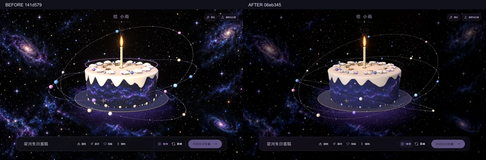
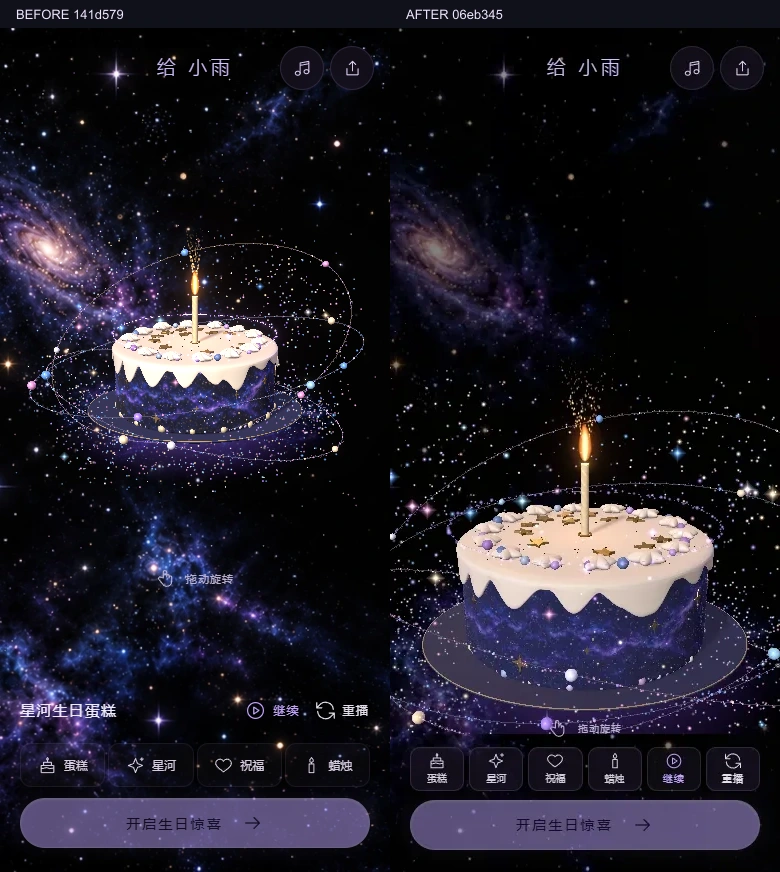
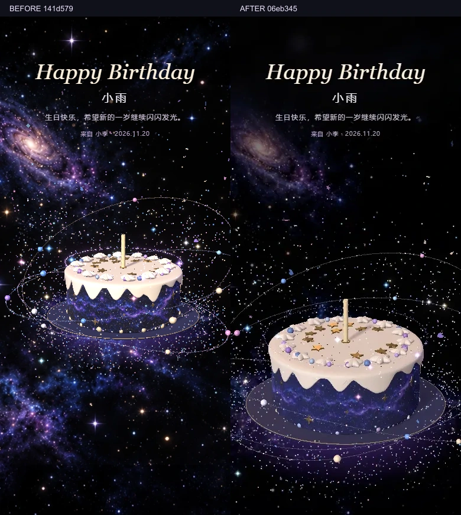

# 首屏与分项优化：2026-11-10 开始，2026-11-12 接续验收

本轮只修改独立 `galaxy-cake/`。起点为干净的 `141d579`；过程中远端新增 `7e69bd7`，已通过 `941a320` 合并，保留该轮材质、装饰、轨道与手机面板改进，没有强制覆盖远端。历史验收和失败尝试均保留在 `qa-optimization-20261110/`。

## 按文件改动

| 范围 | 文件 | 当前行为 |
| --- | --- | --- |
| 庆祝构图 | `src/three/GalaxyScene.tsx`、`src/styles.css` | 庆祝和留言使用全屏画布；镜头平滑留出标题区域，按当前画布换算距离；标题下渐隐柔化星点，避免硬边。入场时间不变。 |
| 爱心队列 | `BirthdayOpening.tsx`、`openingCards.ts`、`openingTiming.ts` | 先标题，再从共同入口连续前进成心；按真实周长与可用区域共同计算数量、尺寸。20–48/20–32 是上下限，不强行固定数量；原文祝福保留。信纸不透明、最上层，完成后静止。 |
| 焦点与失败 | `GalaxyScene.tsx`、`BirthdayExperience.tsx` | Canvas 内隐藏 fallback inert；真正创建失败、上下文丢失或懒加载失败通过外层可见页提供重试。 |
| 首屏加载 | `BirthdayExperience.tsx`、`useExperience.ts`、`galaxyAppearance.ts`、`vite.config.ts` | 点击前仅 DOM 开场，不下载/初始化 Three、renderer 或 Canvas。点击立即显示“星光正在汇聚”，资源就绪后才推进原入场。QA 布局按需加载，颜色计算不运行时引用 Three。 |
| 统一时钟 | `experience/engine.ts`、`useExperience.ts` | 页面级一个推进时钟，DOM 与场景共用；后台、设置开场、模态冻结时不累计停顿。 |
| 音乐 | `gifts/useMusic.ts`、`public/audio/`、`audio/masters/` | 原创完整 48 秒配乐改为单声道 AAC/M4A，388,627 字节。WAV 母带保留在源码 `audio/masters/starlight-letter.wav`，不再公开下载；点击后播放、循环、静音保存规则保留。 |
| 布光表面 | `GalaxyScene.tsx`、`pastryMaterials.ts`、`pastryGeometry.ts`、`CandleGlow.tsx`、`Particles.tsx` | 降主光和大面积高光，加低强度暖轮廓光；确定性滴边、五瓣花大小/朝向变化、火星横向漂移。CSS/GL 星空统一 0.6 亮度，保留上游遮罩与颜色联动。 |
| 手机与模态 | `ControlBar.tsx`、`styles.css`、`subjectFraming.ts`、`BirthdayExperience.tsx` | 六个工具一行、惊喜一行。完整蛋糕/蜡烛/底托投影决定取景；许愿/分享停时钟并切需求渲染，高清导出按需绘制后还原最后一帧。 |
| 通用分享 | `index.html`、`vite.config.ts`、`public/share/`、`public/icons/`、`site.webmanifest` | 通用 OG/Twitter 大图、真实渲染 1200×630 图、原创图标和 manifest；未配置正式域名时使用本机相对资源，不伪造分享地址。无 Service Worker。 |
| 验收 | `scripts/verify-optimization*.cjs`、既有五套回归 | 固定构建 SHA，顺序运行 GPU 检查；新目录保存截图、真实浏览器 WebM、数值和失败信息，不覆盖历史证据。 |

没有改变生日配置、版本 1 礼物载荷、公共路由、草稿、Supabase 格式、依赖或锁文件。保留 12 款/16 类配件、逐层合拢编辑、历史操作、陶瓷底托与原粒子预算。

## 时间与复现

共享开场时间：标题 0–0.8s，队列 0.8–5.0s，标题退场/信纸与按钮 5.0–5.6s，5.6s 可进入，5.8s 完全停稳；跳过和减少动态效果直接 ready。旧文档中的固定 48/32 张及 6.5 秒仅为历史。

```powershell
# 已有克隆先保存自己的修改，再在仓库根目录执行
git pull --ff-only
cd galaxy-cake
pnpm install --frozen-lockfile
pnpm typecheck
pnpm build
pnpm preview --port 4174 --strictPort
```

使用固定 pnpm 11.25.0。默认开发 `pnpm dev` 为 5173。这里验收使用 4174，避免占用其他应用；新电脑可选空闲 4173。生产验收开始后不再替换 `dist/`。

浏览器插件不可用，因此使用隔离 Playwright + 本机真实 Chrome。QA 所需 Playwright/Sharp 来自本机工具运行环境，不加入项目运行依赖；另一台电脑需自行准备测试工具，并将它们的模块目录设为 `NODE_PATH`。

```powershell
$env:QA_URL='http://localhost:4174'
$env:QA_OUTPUT='../docs/qa-optimization-20261110/your-new-run'
node scripts/verify-optimization-suite.cjs
# 只重测指定任务可设置 QA_ONLY='seam,framing,heart'
```

套件禁止覆盖已有汇总文件，且每项后校验 `dist/index.html` SHA。原有 `verify-browser`、`verify-birthday-opening`、`verify-heart-convoy`、`verify-living-sky`、`verify-stage-three` 均继续维护，不降低重叠、文本、边界断言。

## 验收证据索引

- `before/`：141d579 的 1440×900、390×844 改前实拍与状态。
- `step01-*` 至 `step07-*`：分项开发/验证；中间失败或采样校准不能作为最终通过证据。
- `merge-final-visual/`、`merge-sky/`：合并上游后的视觉和背景对齐复验。
- `final/`：17eee20 固定构建完整回归。核心 14、开场 14、星空 16、第三阶段本机 16、全目录五轮切换通过。此轮爱心“右侧”采样过晚、逐层套件 URL 缺 QA 参数、接缝亮度三项失败，不能称全套通过；其结果保留。
- `composition-recheck/`：11 月 10 日镜头修订后的运行被会话中断，仅部分截图，无完成汇总，不能称通过。
- `composition-recheck-20261112/`：运行环境更新后旧 NODE_PATH 失效，未启动浏览器，不作为产品失败或通过。
- 后续验收目录与最终数值见下方接续结果；只认实际生成的结果与构建版本。

## 已实测数值与范围

17eee20 固定构建：首屏无 Canvas/Three/renderer 请求，最长任务 88ms；ready 5944.8ms（引擎 5.6061s）；点击反馈 75.34ms，冷加载与初始化合计 807.3ms，资源就绪到入场 0.30ms。此为本机冷缓存测量，不是公网网络承诺；一次较慢试验超过 6s 的原记录仍保留。

固定两处纯奶油椭圆采样共 344 像素，排除蜡烛、星饰、裱花与星轨，同位置 R>250 比例从 74.13% 降至 0%。侧面亮度 59.01→52.84（保留 89.5%）；没有靠整体压黑通过。桌面 84 draw calls/15,492 Points，手机 56/5,280，低档点数与原预算一致。独立数学验证 252 组颜色与现用 Three 运算的输出 hex 一致。

主方向光 2.6→1.5，环境强度 0.65、暖轮廓光 0.55、Bloom 0.48，奶油材质亮度系数 0.86；CSS/GL 星空共同采用显示空间 0.6 系数。桌面预算仍为 near 300 / far 700 / dust 1740 / surface 3200 / orbitDust 400 / sparks 256 / burst 350；低档为 150 / 300 / 600 / 1000 / 180 / 64 / 120、DPR 1。GPU Points 计数与配置预算分别记录，不把它们混为一个数。

390×844 待机画布 420px，完整主体高 302.99px（72.14%），到底栏间距 27.30px。四种手机视口的单层/复杂三层/巧克力检查已执行；模拟触摸尺寸不代表手机实机性能。

模态 650ms 对照：正常连续绘制 40 帧，打开后 0 帧；高清导出 1 次需求帧，导出后继续 0 帧。浏览器 TaskDuration 约 95.5→5.36ms，仅作本机任务耗时对照，不等同整机 CPU 百分比。音乐两轮循环以 4×速度实播验证完整曲目、循环边界与后台恢复；没有把加速测量写成实时 96 秒聆听。

## 未做、存疑与风险

- 未部署公网，未让分享平台抓取；正式域名未配置时不声明公开 OG 成功。配置已有 `VITE_PUBLIC_SITE_URL` 后需重新构建，SPA 静态页面只提供通用 meta。
- 未接真实 Supabase/账号或改数据库；本机草稿不会跨电脑同步。
- 未做手机实机 GPU/温度/电量测试，Chrome 模拟结果仅证明布局和交互。
- 未做 drei 深路径导入、导出 toBlob/内存扩展或新功能；首次点击仍需下载并编译现有 Three 场景。Three chunk 仍有超过 500KB 的构建提醒。
- ANGLE/Three shader 精度与循环梯度警告仍记录在 QA JSON；普通流程没有新增运行时 error。主动禁用 WebGL/网络时的预期报错单独记录。
- 目前仍不宣称摄影级概念图像素一致。奶油几何、实时光照与概念图有可见差异；背景与蛋糕均为可交互实时效果。

## 分项回滚点

| 提交 | 范围 |
| --- | --- |
| 19c0604 | 全屏庆祝/留言和标题构图 |
| f119fbd | 自适应爱心队列与统一时间 |
| 0d73cf6 | 隐藏 fallback 焦点与实际错误重试 |
| 21ad4fc | 首屏延迟 3D、单时钟、AAC 音乐 |
| d232f55 | 布光、表面、火星和背景亮度 |
| 941a320 | 合并上游 7e69bd7；勿普通 revert 此 merge |
| f13a7d0 | 手机操作/取景与模态需求渲染 |
| 17eee20 | 通用分享 metadata、实拍图和图标 |
| 06eb345 | 手机全屏切换时镜头距离换算、渐隐标题暗底及专项证据 |

普通分项可 `git revert <commit>`，先检查后续依赖并解决冲突；回滚时保留上游与历史证据。合并前备份分支为 `codex/optimization-before-upstream-20261110`。`330904e` 仅归档既有完整回归和测试校准，不改变运行行为。接续时应核对远端分支，而不能只看本机提交。

## 11 月 12 日接续结果

固定构建 SHA-256 为 `a0e8ecfb3bdfcc080507d3c10f27a73339597bc42408d4ef4b60ad51aca7d854`，对应运行源码 `06eb345`。恢复会话后重启服务，测试期间不再构建。

[最终套件汇总](qa-optimization-20261110/final-recheck-20261112/suite-results.json) 的 11 个任务全部 exit 0，包括指定五套、加载、焦点、模态、视觉、通用分享资源与逐层编辑 13 项。加上同一构建的接缝与四尺寸庆祝专项，当前计划中的本机验收已完成。全目录 12 款/16 类与五轮切换的证据为 `final/catalog/browser-results.json`，对应 `17eee20`；后续只改变庆祝镜头/标题暗底，没有更改目录几何与配件，因此没有再跑第二轮全目录。不同构建版本已明确区分。

本轮 `pnpm typecheck`、`pnpm build` 通过，构建仍有 Three 大 chunk 提醒；最终复验后再次 `typecheck` 通过且构建 SHA 未变。`package.json`/`pnpm-lock.yaml` 与起点一致，外层生日网站未修改。全部普通流程无新增运行时 error；预期 WebGL/网络失败与既有 shader warning 分开记录。

- [接缝数值](qa-optimization-20261110/composition-recheck-20261112-r2/seam/seam-results.json)：桌面庆祝/留言差 0.57%/1.48%，手机 2.30%/7.49%，四项均 <10%。量测暂时隐藏文字层以排除字形像素，保留实际渐隐暗底；截图保留完整 UI，肉眼未见直线。
- [手机庆祝取景](qa-optimization-20261110/framing-20261112-r3/framing-results.json)：390×844、375×667、412×915、360×640；默认单层和三层彩虹，每款在高潮 1.6s/3.7s 与留言检查，共 24 组。蛋糕/蜡烛/底托均在画布内，标题在上，重播在下。
- [最终核心回归](qa-optimization-20261110/final-recheck-20261112/core/results.json)：14 项通过，五轮均 63 geometries/44 textures；本机桌面待机约 59.76 FPS、庆祝 55.16 FPS，手机模拟约 59.92/55.46 FPS。此为 Chrome 桌面 GPU 与模拟视口结果。
- 接缝第一次接续的 framing 测试等待了该阶段本来不存在的重播元素而超时，修正测试为出现后才读取，严格边界条件保持不变；原失败 JSON 保留。
- [爱心动态结果](qa-optimization-20261110/final-recheck-20261112/heart/results.json)：1440/390/360/375/412 宽度分别 22/21/20/20/22 张，最大两卡面积重叠 1.41%/9.14%/14.61%/10.69%/8.50%，全部 <25%，文字与路径越界记录均为 0。共同入口、三卡前后顺序、同卡长距离移动和最终静止均通过。原“右侧”坐标断言移到实际经过右侧的 3.5s，4.5s 已在回到顶部，并未降低布局断言。
- [完整实际开场录屏（MP4）](qa-optimization-20261110/delivery/heart-opening.mp4) 为真实 Chrome 录制约 17.5s，包含标题、移动队列、闭合信纸、点击和蛋糕入场；[原始 WebM](qa-optimization-20261110/final-recheck-20261112/heart/heart-convoy.webm) 同时保留。MP4 只作容器/编码转换，没有合成动画或加速。
- [最终首屏冷缓存](qa-optimization-20261110/final-recheck-20261112/loading/loading-results.json)：ready 5818.1ms（引擎 5.6052s），最长任务 77ms，点击前 Canvas/Three/renderer 请求均无；点击反馈 65.95ms，冷下载+初始化 773ms，资源就绪→入场 0.20ms。48s 音乐两轮加速实播与后台恢复通过；主动拦截场景模块时出现可见重试页。
- [最终焦点与 WebGL 降级](qa-optimization-20261110/final-recheck-20261112/accessibility/accessibility-results.json)：前五次 Tab 为蛋糕、星河、祝福、蜡烛、暂停，全为可见 44px 控件；首次禁用 WebGL 和主动丢失上下文均显示真实降级页，重试可用。
- [星空 16 项](qa-optimization-20261110/final-recheck-20261112/sky/results.json) 及 [本机第三阶段 16 项](qa-optimization-20261110/final-recheck-20261112/stage-three/stage-three-results.json) 已通过。包括真实颜色/运动、暂停/后台/减少动态效果、三种手机、图片下载、恢复草稿和只读流程；云端未配置的状态必须诚实显示。
- [模态与手机操作专项](qa-optimization-20261110/final-recheck-20261112/mobile-modal/mobile-modal-results.json)：650ms 活跃窗口 40 帧，模态 0 帧，导出 1 帧后继续冻结；本轮 TaskDuration 94.15→6.20ms。许愿/取消/确认吹灭和关闭恢复均通过，静音与暂停偏好继续保留。
- [最终视觉采样](qa-optimization-20261110/final-recheck-20261112/visual/visual-results.json)：同样 344 个纯奶油像素，过亮 0%，侧面亮度 52.82，约为原始 89.5%；桌面 84 calls/15,492 Points，低性能 2,774 Points 预算未增加。
- [本机通用分享资源](qa-optimization-20261110/final-recheck-20261112/meta/meta-results.json) 均返回 200，图片尺寸 1200×630，图标与 manifest 可读取。[配置域名的纯构建测试](qa-optimization-20261110/step07-meta/origin-fixture.json) 使用保留测试地址，验证生成绝对 URL；它不是已发布的网站或爬虫成功记录。

| 视口 | 待机完整主体/画布高度 | 主体到底栏间距 |
| --- | --- | --- |
| 390×844 | 72.14% | 27.30px |
| 375×667 | 68.93% | 36.41px |
| 412×915 | 76.93% | 13.65px |
| 360×640 | 65.76% | 45.36px |

四项均 ≥55%、间距 <120px，无水平溢出；第一行六个工具、第二行惊喜按钮的尺寸均 ≥44×44。三层与巧克力亦检查，详见专项 JSON。

以下是实际生产浏览器截图的原尺寸比例对照，并非概念图或预渲染结果。两侧均为入场后暂停，自动旋转的采样时刻有轻微差异；截图和引擎状态分别留档。






